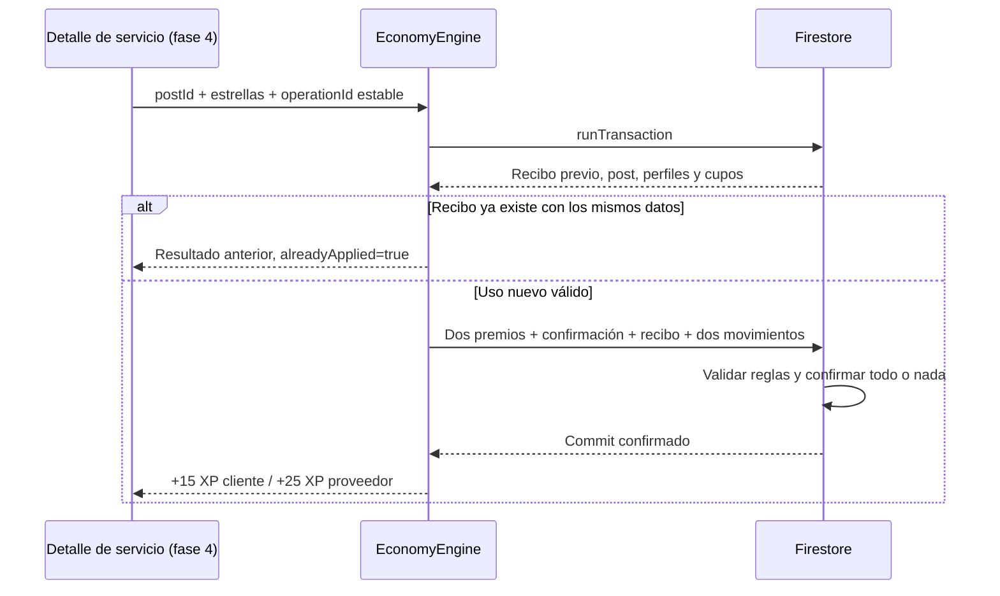

# Fase 2 — Motor de Visto Bueno Vecinal

## Entrega
Motor preparado e inyectado como EconomyEngine mediante Provider. No añade botón, selector, navegación ni cambios visuales; el botón corresponde a fase 4 y el ranking visual a fase 3.
Mantiene la base de fase 1 y las decisiones aprobadas: ranking mensual por distrito con texto «del barrio», monedas privadas visibles después en perfil, Inicio con XP y Star, y mochila por fotografía pendiente.

## Contrato del motor
```dart
final engine = context.read<EconomyEngine?>();
// Guardar una vez por uso real, también entre reintentos y reinicios de app.
final operationId = engine!.newOperationId();
final result = await engine.confirmService(
  postId: post.id,
  rating: 5,
  operationId: operationId,
);
```
El cliente no suministra UID del proveedor ni cantidades de XP o monedas. El UID del cliente proviene de AuthGateway y el proveedor de authorId del post leído en la transacción.
El servicio debe pertenecer a posts, category=service y status=active. Incluye publicaciones de ambos modos actuales de Servicios. Requiere ambos perfiles existentes, saneados y con campos de economía; no crea un proveedor ficticio ni migra datos ajenos.
Una calificación entera de 1 a 5 es obligatoria. La sesión debe existir, sin crear otra identidad anónima silenciosamente.
Si falta sincronizar el perfil propio puede usarse UserRepository.ensureUser antes del flujo. El proveedor debe sincronizar su propio perfil; el cliente no tiene acceso a sus documentos privados.

## Una sola operación atómica
Se leen primero recibo, post, dos perfiles y dos cupos. Después se escriben seis documentos:
1. users/{cliente}: +15 xp y +15 monthlyXp.
2. users/{proveedor}: +25 xp y +25 monthlyXp, reviewCount+1 y promedio actualizado.
3. serviceConfirmations/{periodo}_{cliente}_{proveedor}_{cupo}.
4. users/{cliente}/serviceOperations/{operationId}.
5. users/{cliente}/movimientos/{confirmationId}.
6. users/{proveedor}/movimientos/{confirmationId}.

No se lee ni se escribe la cuenta privada del proveedor. Las monedas no cambian.
El incremento mensual parte de cero si el periodo guardado es anterior. Un periodo futuro detiene la operación para evitar pérdida de puntos. El XP total nunca se reinicia.



## Límite e idempotencia
Hay dos cupos por pareja cliente/proveedor y mes de Lima. El segundo exige que el primero exista antes de la transacción. El tercero se rechaza.
Dos usos distintos de la misma publicación están permitidos, cada uno con diferente operationId. Otra publicación del mismo proveedor comparte el límite.
Un reintento conserva operationId y estrellas. Si existe recibo devuelve el resultado anterior sin escribir, incluso si cambió el mes o se eliminó el post.
Reutilizar el identificador con otro post o calificación produce operationConflict.
El caller de fase 4 debe persistir el identificador al iniciar una confirmación y mantenerlo durante errores de red. Crear otro ID en cada toque anularía la semántica de reintento.
El backend no puede probar que hubo dos trabajos físicos diferentes: aplica el límite a usos declarados. Esta limitación forma parte del prototipo.

## Movimientos inmutables
Cada movimiento incluye id, confirmationId, uid, counterpartyUid, type, sourceId, deltaXpTotal, deltaXpMonth, deltaCoins=0, period, status=released y createdAt del servidor.
Tipos: service_used_client y service_provided.
Confirmaciones, recibos y movimientos permiten solo create; jamás update/delete desde clientes. Cada dueño lee su propio libro; el cliente no puede leer el libro del proveedor.
Las confirmaciones se pueden leer por ID por sus participantes. Los recibos solo por el cliente.

## Seguridad comprobada en servidor
Las reglas enlazan los seis documentos con getAfter y exigen que la confirmación no existiera antes. Verifican:
- UID autenticado del cliente, autor real del post, categoría y estado.
- No auto-confirmación, cupo 1/2, periodo según request.time UTC−5 y calificación.
- Incrementos EXACTOS +15/+25, reinicio mensual correcto y campos de perfil sin cambios ajenos.
- Promedio de estrellas con aritmética decimal, contando una sola reseña.
- Recibo nuevo y dos movimientos completos con 0 monedas.
- Imposibilidad de reutilizar una confirmación anterior para subir XP otra vez.
- Imposibilidad de guardar una confirmación sin sus dos premios y dos movimientos.

Se verificaron en emulador transacciones válidas, ambas plazas y carreras, respetando los límites de acceso documental de reglas.
Referencia oficial: [transacciones y getAfter](https://firebase.google.com/docs/firestore/manage-data/transactions), [condiciones y límites](https://firebase.google.com/docs/firestore/security/rules-conditions).

Riesgo residual: múltiples cuentas anónimas permiten simular personas distintas. Para producción se requiere identidad verificable y validación de negocio en servidor. No se presenta la calificación de un usuario como prueba independiente del servicio.
No se abre acceso público a teléfonos, monedas privadas ni datos SOS.

## Errores y extensiones
EconomyFailure tiene motivos tipados para sesión, auto-confirmación, cupos, calificación, operación reutilizada, servicio, perfiles, periodo futuro, red, permisos y simulación. economyFailureMessage los traduce al español para la UI futura.
Una pérdida de conexión requiere reintentar con el mismo identificador, porque una respuesta perdida no demuestra que el commit no ocurrió.
EconomyEngine.award(source: ...) admite serviceUse. completedFavor y attendedEvent fallan explícitamente con unsupportedSource hasta definir evidencia y reglas, sin inventar premios.
El motor bloquea escrituras si se configura FakePeriodProvider por defecto; la futura herramienta de simulación debe conservar ese bloqueo y no habilitar el override reservado a pruebas.

## Validación
- flutter analyze --no-pub: sin incidencias.
- flutter test --no-pub: 149 pruebas aprobadas (19 nuevas del motor).
- Suites de reglas anteriores y nueva suite de servicio: aprobadas en Auth/Firestore/Storage emulados.
- Casos negativos incluyen premios parciales, aumentos manipulados, monedas, estrellas, proveedor falso, auto-confirmación, segundo cupo sin primero, tercer cupo, recibo repetido, periodo futuro, edición/borrado de libro y lectura ajena.
- Concurrencia de un mismo operationId: un solo premio confirmado.

```powershell
flutter analyze --no-pub
flutter test --no-pub
firebase emulators:exec --project demo-hackaton-hello-world --only auth,firestore,storage "node test/firebase_rules_test.mjs && node test/economy_rules_test.mjs && node test/service_economy_rules_test.mjs"
flutter build web --debug --no-pub
```

## Despliegue
No se desplegaron reglas ni se escribieron datos de producción.
Si la fase 1 ya está desplegada, esta fase requiere actualizar firestore.rules:
```powershell
firebase deploy --only firestore:rules
```
Si la fase 1 sigue pendiente, cumplir primero el orden de índices, funciones SOS y reglas indicado en economy_and_ranking.md.
No hay índices nuevos en fase 2: cupos, recibos y movimientos se acceden por ID.

## Impacto UI
- lib/main.dart: únicamente construcción/inyección de EconomyEngine por interfaz. Sin cambios visuales.
- lib/features/economy/presentation/economy_failure_messages.dart: mensajes para usar en la fase 4; no agrega widgets.
No se modificaron layouts, colores, tipografías, espaciados, iconos, navegación ni textos visibles de las pantallas existentes.
No se añadieron dependencias ni se cambiaron versiones.


Compilación web de esta entrega: flutter build web --debug --no-pub completada correctamente.

## Archivos de esta fase
- lib/main.dart
- lib/features/economy/presentation/economy_failure_messages.dart
- lib/features/economy/domain/services/service_economy_engine.dart
- lib/features/economy/domain/services/economy_engine.dart
- lib/features/economy/domain/repositories/economy_store.dart
- lib/features/economy/domain/models/economy_result.dart
- lib/features/economy/data/firestore_economy_store.dart
- test/service_economy_rules_test.mjs
- test/economy_engine_test.dart
- docs/economy_phase2.md
- docs/economy_and_ranking.md
- firestore.rules
